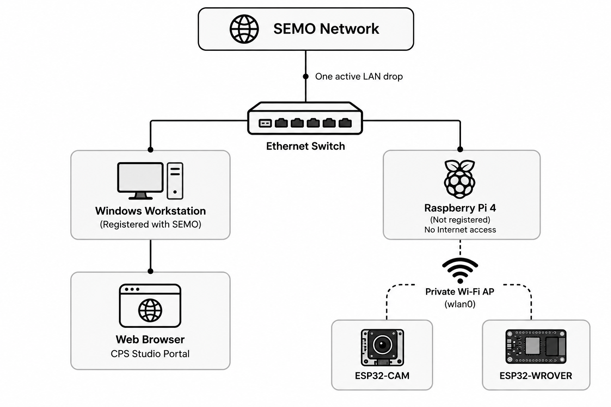

# CPS Studio

CPS Studio is a platform for hands-on experimentation with cyber-physical systems (CPS), developed as part of my M.S. Cybersecurity thesis research at Southeast Missouri State University.

The system uses a Raspberry Pi Gateway to connect users with ESP32-based devices through a web browser. Students can run supported experiments without direct access to the Raspberry Pi, device firmware, or underlying infrastructure.

The Gateway manages device communication, checks requests, enforces execution limits, and records experiment activity.

The project combines embedded systems, networking, cybersecurity, software development, system monitoring, and machine learning.

### [Explore the Interactive Simulator](https://ctarique.github.io/cps-studio/)

The online simulator demonstrates the Gateway Portal, CPS Apps, Lab Display, and Digital Twin without requiring access to the physical laboratory. It uses simulated device responses rather than live hardware.

---

## Overview

CPS Studio began with a practical question: how can students experiment with physical computing systems without needing administrative access to the infrastructure running them?

A CPS experiment might involve controlling an LED, reading sensor data, operating a small vehicle, or observing how a device responds to software commands. These activities are useful for learning, but unrestricted access to the underlying systems introduces security and operational risks.

CPS Studio addresses this by placing a Raspberry Pi Gateway between users and physical devices. Students access supported experiments through the Gateway Portal. The Gateway checks requests and communicates with the devices, while system administration, firmware management, and other privileged operations remain separate. This allows students to work with real hardware through a controlled interface.

---

## System Architecture



*Figure 1. CPS Studio Network.*

### How It Works

The laboratory workstation and Raspberry Pi are connected through an Ethernet switch.

Students access the Gateway Portal through a web browser on the workstation. They do not directly administer the Raspberry Pi or communicate with the embedded devices.

The Raspberry Pi hosts a separate private Wi-Fi network for communication with the ESP32 devices. The Gateway application handles requests between the browser and the hardware.

A television connected to the Pi through HDMI presents experiment status, device information, and visual content.

### Main Components

| Component | Description |
|---|---|
| **Gateway** | Raspberry Pi 4 running the Gateway application |
| **Gateway Portal** | Browser interface for accessing CPS Apps |
| **ESP32-CAM** | Embedded device used for the LED Flasher experiment |
| **ESP32-WROVER** | Vehicle platform with camera, sensors, and motor control |
| **Lab Display** | HDMI-connected television for experiment information and visual content |
| **Digital Twin** | Read-only visualization of supported device activity and telemetry |
| **Instructor Administration** | Separate interface for managing experiment access and recovery |

---

## CPS Apps

CPS Studio currently includes two experimental applications.

### 1. LED Flasher

The LED Flasher introduces embedded programming and device control using an ESP32-CAM.

It supports two modes of operation.

**Guided Control**

Users can turn the onboard LED on or off through predefined controls. The Gateway processes the commands and forwards permitted operations to the device.

**Custom Program**

Users can write small programs using a restricted set of supported operations.

For example:

```cpp
void experiment() {
    led(1);
    wait_ms(500);
    led(0);
}
```

Supported operations include:

- `led(1)` — Turn the LED on.
- `led(0)` — Turn the LED off.
- `wait_ms(n)` — Wait for a permitted duration.
- `status()` — Include a supported status operation.

The Gateway checks submitted programs before execution. Limits apply to source length, operation count, waiting time, and execution behavior.

The ESP32 firmware independently checks prepared instructions and enforces device-side execution limits.

Students cannot upload arbitrary firmware, execute unrestricted C/C++, or modify device configuration through this interface.

**Guided Control and Custom Program execution have both been exercised on physical ESP32-CAM hardware.**

### 2. Autonomous Car

The Autonomous Car application uses an ESP32-WROVER-based vehicle with a camera, sensors, and motor-control hardware.

Implemented functionality includes:

- Gateway-mediated vehicle communication.
- Camera capture.
- Four bounded directional motor tests.
- LDR sensor readings.
- Wi-Fi signal-strength telemetry.
- Experiment status reporting.
- Digital Twin integration.
- Predefined track presentations through the Lab Display.

The Gateway manages supported requests, while the vehicle firmware handles local sensing, motor behavior, and execution limits.

The application also includes **TV-as-a-Track**, an experimental setup where a television displays predefined tracks intended to be sensed by the physical vehicle.

The track presentation system and supported vehicle controls have been implemented. Autonomous track following and formal physical validation remain in development.

---

## Gateway Security

CPS Studio separates student interaction, system administration, and physical device operations.

The Gateway provides several security controls to limit access and restrict what experiments can execute.

### Access Control

Students access experiments through the designated laboratory workstation and authorized network.

The Gateway checks permitted actions, experiment policies, and current execution state before processing requests.

Student access does not provide instructor privileges or operating-system administration.

Instructor web administration uses separate credentials and sessions. Raspberry Pi system administration is handled independently through SSH public-key authentication.

### Network Isolation

The Raspberry Pi uses two network interfaces:

- **Ethernet (`eth0`):** Laboratory workstation and administrative network access.
- **Wi-Fi (`wlan0`):** Private network for connected ESP32 devices.

IP forwarding between the networks is disabled.

Linux nftables rules restrict network access. Workstation traffic is not routed directly to the embedded devices.

Supported device communication takes place through the Gateway application.

### Device Communication

Gateway-to-device communication uses **HMAC-SHA256 message authentication**, device-specific credentials, and protocol checks.

The protocol checks message identity, freshness, and request correlation to reject invalid or unsupported exchanges.

Connecting to the private Wi-Fi network does not, by itself, authorize device operations.

### Execution and Recovery

The Gateway checks experimental requests before forwarding them to devices.

Controls include:

- Restricted experiment operations.
- Program and command validation.
- Execution limits.
- Device readiness checks.
- Experiment state management.
- Stop and recovery procedures.
- Records of accepted, rejected, and interrupted operations.

Trusted device firmware provides another enforcement layer for supported operations.

These mechanisms are designed to restrict unauthorized commands and limit the effects of incorrect experimental requests.

---

## Lab Display and Digital Twin

CPS Studio includes a Lab Display presented on a television connected directly to the Raspberry Pi.

It provides a shared view of laboratory activity without exposing the Gateway's administrative interfaces.

Depending on the selected experiment, the display can show:

- Gateway and experiment status.
- Device connectivity.
- Active CPS Apps.
- LED Flasher visualizations.
- Autonomous Car information.
- Predefined track layouts.
- Digital Twin views.

### Digital Twin

The Digital Twin is a read-only visualization of supported CPS activity.

It uses Gateway events and available device telemetry, including round-trip time (RTT) and received signal strength (RSSI), to represent device and experiment states.

Some visualizations are based on requested commands, while others use device-reported information.

These are not equivalent to direct observation of physical behavior.

The Digital Twin does not control actuators or independently verify that an operation succeeded on physical hardware.

---

## Monitoring and Analysis

CPS Studio includes supporting software for system observation and offline security analysis.

These components are separate from the Gateway's access-control and device-execution functions.

### eBPF Observability

The project uses **eBPF/BCC** to collect selected Linux kernel events associated with Gateway activity.

The observer supports monitoring of scoped connection attempts and process-execution events.

Collected records provide information for analyzing system activity and evaluating experiments.

### Feature Extraction

A supporting analytics component processes recorded events into behavioral features.

The implementation uses complete ten-second observation windows and distinguishes between:

- Valid periods of inactivity.
- Incomplete records.
- Gaps in data collection.

This helps preserve the meaning of collected observations during analysis.

### Offline AI Analysis

CPS Studio includes an offline anomaly-analysis pipeline using **Isolation Forest**.

The pipeline supports:

- Behavioral feature processing.
- Model training.
- Separate calibration.
- Anomaly scoring.
- Deterministic security indicators.
- Retained analysis results.

Isolation Forest identifies unusual behavior relative to its training data. An anomaly score does not, by itself, establish that an attack occurred.

AI analysis runs offline. It cannot change Gateway policies, stop experiments, or control physical devices.

The monitoring and analysis components have been exercised during development on the Raspberry Pi. Formal laboratory evaluation remains in progress.

---

## Interactive Simulator

### [Launch CPS Studio Simulator](https://ctarique.github.io/cps-studio/)

The online simulator allows visitors to explore CPS Studio without installing software or accessing laboratory hardware.

It reproduces the main interfaces and selected experimental workflows using simulated device responses.

| Feature | Description |
|---|---|
| Gateway Portal | Main browser interface |
| CPS Apps | LED Flasher and Autonomous Car |
| Lab Display | Simulated laboratory television |
| Digital Twin | Visualization of simulated device activity |
| Split Screen | Gateway Portal and Lab Display shown together |
| Track Library | Twelve predefined track layouts |
| Experiment Workflows | Interactive demonstrations of supported operations |

The simulator is a standalone HTML application located at:

`docs/index.html`

It can also be opened locally in a compatible web browser.

**Limitations:** The simulator demonstrates interface behavior and experimental workflows. It does not communicate with physical ESP32 devices or provide evidence of hardware performance or security effectiveness.

---

## Running the Gateway Locally

The repository also includes a Python-based software simulator.

Unlike the standalone HTML demonstration, this environment runs the Gateway application and allows local testing of supported workflows.

### Requirements

- macOS or Linux
- Python 3.11 or newer
- C++17 compiler for native firmware checks
- Internet access for initial dependency installation

### Installation

Clone the repository:

```bash
git clone https://github.com/ctarique/cps-studio.git
cd cps-studio
```

Create a virtual environment, install dependencies, and run the Gateway:

```bash
cd current-gateway

python3 -m venv .venv
source .venv/bin/activate

python -m pip install --require-hashes -r requirements.lock

python tools/verify_bundle.py
python tools/test.py
python tools/home.py
```

Once the Gateway starts, open:

**Gateway Portal:** http://127.0.0.1:8080

**Administration:** http://127.0.0.1:8080/admin

### Local Administration

The launcher generates local administrator credentials in:

```text
current-gateway/.local/home.env
```

Read the generated credentials locally to access Administration.

The software simulator supports Gateway workflow testing, including permitted LED Flasher operations and Custom Program checks.

Local runtime files, generated credentials, and evidence are stored under:

```text
current-gateway/.local/
```


Stop the Gateway with `Ctrl-C`.

The local simulator does not automatically configure, provision, or operate physical ESP32 devices.

---

## Technology Stack

| Area | Technologies |
|---|---|
| Hardware | Raspberry Pi 4, ESP32-CAM, ESP32-WROVER |
| Programming | Python, C/C++, JavaScript |
| Web Interface | Flask, HTML, CSS, JavaScript |
| Operating System | Linux / Raspberry Pi OS |
| Networking | Ethernet, Wi-Fi, TCP/IP |
| Network Security | nftables, network isolation, SSH |
| Device Security | HMAC-SHA256, authenticated device protocols |
| Observability | eBPF/BCC, Linux kernel events |
| Data Processing | Python, structured event records |
| Machine Learning | scikit-learn, Isolation Forest |
| Development | Git, software testing, firmware testing, simulation |

---

## Repository Structure

| Directory | Contents |
|---|---|
| `current-gateway/gateway/` | Gateway application, templates, and static assets |
| `current-gateway/esp32/` | ESP32-CAM and ESP32-WROVER firmware |
| `current-gateway/tests/` | Software and firmware tests |
| `current-gateway/config/` | Example configurations |
| `current-gateway/tools/` | Verification, testing, and local simulation |
| `current-gateway/docs/` | Engineering and deployment documentation |
| `supporting-software/` | Observer, analytics, and AI analysis components |
| `deployment/` | Deployment reference and instructor utilities |
| `docs/` | Interactive browser simulator and related assets |

### Documentation

Additional information about the public source release is available in:

- [Source Status](SOURCE-STATUS.md) — Source details and limitations.
- [Verification](VERIFICATION.md) — Software checks and release verification.
- [Sanitization](SANITIZATION.md) — Changes made for public release.
- [Publication](PUBLICATION.md) — Publication and licensing information.

---

## Development Status

CPS Studio is an active research and development project.

The Gateway, CPS Apps, Lab Display, and monitoring components are at different stages of implementation and testing.

| Component | Status |
|---|---|
| Raspberry Pi Gateway | Implemented and exercised on physical hardware |
| Gateway Portal | Implemented |
| LED Flasher — Guided Control | Physically exercised |
| LED Flasher — Custom Program | Physically exercised |
| ESP32-WROVER Camera | Physically exercised |
| ESP32-WROVER Motor Tests | Physically exercised |
| ESP32-WROVER Telemetry | Implemented and exercised |
| Lab Display | Operational HDMI presentation |
| Digital Twin | Implemented with device-event and telemetry integration |
| eBPF Observer | Implemented and development-tested |
| Offline Isolation Forest | Implemented and development-tested |
| Autonomous TV-as-a-Track | In development |
| Formal Laboratory Evaluation | In progress |

The project distinguishes software tests, device-reported information, observed physical behavior, and formal experimental validation.

Successful simulation or software testing does not automatically establish physical performance or prove that a security control is effective.

### Public Source Release

This repository contains a sanitized source copy based on the **October 16, 2026 engineering reference**.

It includes the Gateway application, ESP32 firmware, simulation tools, supporting software, and documentation.

Deployment-specific credentials, private configuration, and sensitive runtime information have been excluded from this public copy.

---

## Future Development

CPS Studio was designed to support additional experiments and hardware.

Future work may include new CPS Apps, additional sensors and embedded platforms, expanded monitoring, and further development of the Autonomous Car experiment.

Another area of interest is improving the tools instructors use to configure and maintain the laboratory environment.

---

## Acknowledgments

I developed CPS Studio as part of my master's thesis research at Southeast Missouri State University.

I am grateful to Dr. Zhouzhou Li, Dr. Juefei Yuan, and Bill Green for their guidance and support throughout the project.

Their contributions helped shape the research and its implementation.

---

## Author

**Tarique Chowdhury**  
M.S. Cybersecurity Candidate  
Southeast Missouri State University

[GitHub](https://github.com/ctarique) | [LinkedIn](https://www.linkedin.com/in/ctarique/)

---

## Publication and Licensing

See [PUBLICATION.md](PUBLICATION.md) for the current publication and licensing status.

Public availability of this repository does not automatically grant permission to reuse or redistribute its contents.
